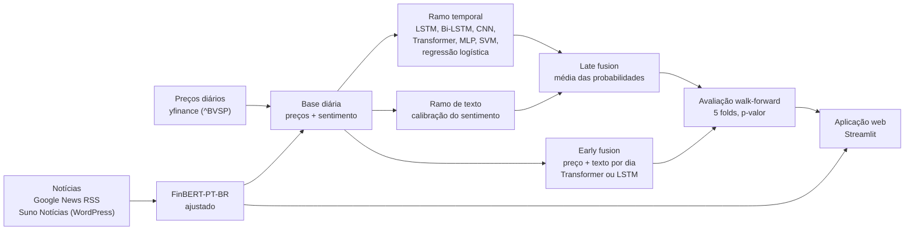

# AlphaPulse

**Monitor de sentimento de notícias financeiras do Ibovespa com IA, com avaliação rigorosa da capacidade de prever o mercado.**

Projeto prático da disciplina **SIN 323 · Inteligência Artificial** (UFV, 2026/2), orientado pela Profa. Dra. Larissa Ferreira Rodrigues Moreira.

> ⚠️ **Projeto acadêmico. Nada neste repositório é recomendação de investimento.**

---

## Sumário

1. [Resumo e principais resultados](#1-resumo-e-principais-resultados)
2. [Problema](#2-problema)
3. [Visão geral da solução](#3-visão-geral-da-solução)
4. [Dados](#4-dados)
5. [Componente de linguagem: FinBERT-PT-BR](#5-componente-de-linguagem-finbert-pt-br)
6. [Previsão de mercado](#6-previsão-de-mercado)
7. [Resultados da previsão de mercado](#7-resultados-da-previsão-de-mercado)
8. [Discussão e análise crítica](#8-discussão-e-análise-crítica)
9. [Aplicação web (PoC)](#9-aplicação-web-poc)
10. [Estrutura do repositório](#10-estrutura-do-repositório)
11. [Como executar](#11-como-executar)
12. [Histórico do desenvolvimento](#12-histórico-do-desenvolvimento)
13. [Limitações e trabalhos futuros](#13-limitações-e-trabalhos-futuros)
14. [Referências](#14-referências)
15. [Licenças e uso de dados](#15-licenças-e-uso-de-dados)

---

## 1. Resumo e principais resultados

O AlphaPulse coleta notícias financeiras reais, mede o sentimento de cada manchete com um modelo de linguagem especializado em finanças (FinBERT-PT-BR, ajustado neste projeto) e combina esse sentimento com o histórico de preços do Ibovespa para tentar antecipar o próximo pregão.

O projeto tem duas conclusões, ambas medidas sem vazamento de dados:

1. **A IA lê notícias financeiras brasileiras com 88,4% de acerto.** O fine-tuning do FinBERT-PT-BR elevou a acurácia de 77,1% para 88,4% em notícias rotuladas por especialistas, nunca vistas no treino.
2. **Notícia não vira previsão confiável do preço de amanhã.** Com validação walk-forward em 630 pregões (abr/2024 a nov/2026), nenhuma das 17 configurações testadas superou o acaso com significância estatística, nem para a direção nem para o risco do próximo pregão. O resultado é coerente com a hipótese de mercados eficientes.

| Componente | Métrica | Resultado | Referência | Conclusão |
|---|---|---|---|---|
| **Sentimento** (FinBERT-PT-BR ajustado) | Acurácia, validação cruzada em 5 divisões | **88,4% ± 1,1%** | 77,1% do modelo original; 57,5% chutando a classe mais comum | ✅ Validado |
| **Direção do próximo pregão** (melhor: Transformer, early fusion) | Acurácia walk-forward, 630 pregões | 52,9% ± 0,4% | 51,1% (chute constante); p = 0,20 | ❌ Não significativo |
| **Risco do próximo pregão** (melhor: LSTM) | Acurácia walk-forward, 630 pregões | 54,1% ± 0,8% | 51,0% (chute constante); p = 0,074 | ❌ Não significativo |

---

## 2. Problema

**Quem enfrenta:** o investidor pessoa física, que não consegue acompanhar o volume diário de notícias sobre a bolsa nem separar o que é relevante do que é ruído.

**O que se propõe melhorar:** transformar o noticiário em um indicador objetivo (o "termômetro de sentimento") e verificar, com rigor, se esse indicador ajuda a antecipar o comportamento do mercado.

**Papel da IA:**

| Tarefa | Entrada | Saída | Decisão apoiada |
|---|---|---|---|
| Classificar o sentimento de cada notícia | Manchete em português | P(positiva), P(negativa), P(neutra) | Leitura rápida do humor do noticiário |
| Prever a direção do próximo pregão | Preços dos últimos 30 pregões + sentimento | P(alta) | Experimental (ver resultados) |
| Prever o risco do próximo pregão | Volatilidade recente + volume e tom das notícias | P(oscilação acima do normal) | Experimental (ver resultados) |

---

## 3. Visão geral da solução



O pipeline tem três etapas, cada uma com um script próprio:

| Etapa | Script | O que faz |
|---|---|---|
| 1. Dados | `gerar_base.py` | Baixa os pregões, coleta notícias, pontua o sentimento e gera a base diária |
| 2. Linguagem | `avaliar_finbert.py`, `finetune_finbert.py` | Valida e ajusta o FinBERT-PT-BR com notícias rotuladas |
| 3. Mercado | `main_ensemble.py` | Treina e avalia os modelos de previsão com walk-forward |
| PoC | `app.py` | Interface web com sentimento, análise de manchetes, sinais e validação |

---

## 4. Dados

### 4.1 Preços

| Item | Detalhe |
|---|---|
| Fonte | Yahoo Finance, via biblioteca `yfinance` (gratuita) |
| Ativo | Ibovespa (`^BVSP`) |
| Período | mar/2018 a nov/2026 (2.095 pregões com alvo definido) |
| Campos | Abertura, máxima, mínima, fechamento, fechamento ajustado e volume |

Durante o horário de negociação, o candle do dia ainda está incompleto; ele é descartado até as 18h (Brasília).

### 4.2 Notícias

| Fonte | Acesso | Como é coletada |
|---|---|---|
| Google News RSS | Gratuito, sem chave | Busca semanal por `Ibovespa OR "Bolsa brasileira"`. Quando uma semana atinge o limite de 100 itens, a janela é dividida ao meio recursivamente (janelas adaptativas) |
| Suno Notícias | API pública do WordPress, sem chave | Busca mensal por termo, paginada de 100 em 100 |

A coleta usada nos experimentos reuniu mais de 11 mil manchetes únicas. Cada janela concluída é registrada em um banco SQLite: se a coleta for interrompida, ela recomeça de onde parou. O GDELT foi testado e descartado, porque bloqueava as requisições com frequência (HTTP 429).

### 4.3 Base rotulada para o componente de linguagem

| Item | Detalhe |
|---|---|
| Base | `Labeled.zip` de Carosia, Silva e Coelho (2022), Repositório de Dados de Pesquisa da Unicamp |
| DOI | [10.25824/redu/GFJHFK](https://doi.org/10.25824/redu/GFJHFK) |
| Licença | CC BY-NC 4.0 |
| Notícias únicas usadas | 1.579 (66 duplicadas ou com rótulos conflitantes removidas) |
| Classes | 632 negativas, 856 positivas, 91 neutras |

A base tem dois formatos: manchetes com rótulo binário (`1|manchete`) e notícias do Bradesco com duas anotações no cabeçalho (−1, 0 ou 1). No segundo formato, interpretamos as anotações como dois anotadores e usamos só as 315 notícias em que eles concordam; as 103 com discordância foram descartadas. Essa interpretação não está documentada pelos autores da base.

### 4.4 Prevenção de vazamento de dados

| Risco | Salvaguarda |
|---|---|
| Notícia publicada depois do fechamento ser usada no mesmo dia | Notícias a partir das 17h (Brasília) contam para o pregão seguinte |
| Notícia de fim de semana ou feriado | Associada ao próximo pregão (`merge_asof` para frente) |
| Mesma manchete em vários veículos | Deduplicação por hash do título normalizado; fica a ocorrência mais antiga |
| Embaralhar a série temporal | Divisões sempre cronológicas |
| Normalização "conhecer" o futuro | `StandardScaler` ajustado só nos dados de treino de cada fold |
| Alvo cruzar a fronteira entre blocos | Purga de *h* pregões entre treino, validação, meta e teste (*h* = horizonte) |
| Escolher hiperparâmetros ou limiares no teste | Tudo é escolhido na validação ou no bloco meta; o teste é usado uma única vez |
| Avaliar o FinBERT ajustado com notícias do treino | Conjunto de teste separado e validação cruzada |

---

## 5. Componente de linguagem: FinBERT-PT-BR

### 5.1 Modelo base

O [FinBERT-PT-BR](https://huggingface.co/lucas-leme/FinBERT-PT-BR) (Santos, Bianchi e Costa, 2023) é um BERT derivado do BERTimbau, adaptado a textos do mercado financeiro brasileiro e treinado para classificar sentimento em três classes: positivo, negativo e neutro.

O score de cada manchete é:

```
score = P(positivo) − P(negativo)        intervalo: [−1, 1]
```

O sentimento diário de cada pregão é a média dos scores ponderada pela confiança do modelo (1 − P(neutro)), para que manchetes ambíguas pesem menos.

### 5.2 Validação do modelo original

Antes de usar o modelo, medimos seu desempenho na base rotulada da Unicamp (`avaliar_finbert.py`):

| Conjunto | Notícias | Acurácia | Baseline | F1 macro | ROC-AUC |
|---|---|---|---|---|---|
| Positivas × negativas, todas as fontes | 1.488 | 77,1% | 57,5% | 0,770 | 0,906 |
| Somente manchetes rotuladas | 1.264 | 77,5% | 56,5% | 0,774 | 0,902 |
| Somente notícias com 2 anotadores | 224 | 75,0% | 63,4% | 0,749 | 0,926 |
| Três classes (com neutras) | 315 | 54,6% | 45,1% | 0,548 | — |

Dois problemas apareceram:

- **Viés pessimista:** recall de 95,7% nas notícias negativas, mas só 63,3% nas positivas. O score médio de uma notícia positiva era +0,12, quase neutro.
- **Falta de contexto de mercado:** em "Dólar volta a cair e vai a R$ 4,01", o modelo reagia à palavra "cair" e respondia negativo, embora dólar em queda costume ser positivo para a bolsa brasileira.

**Onde o modelo original errava:**

| Padrão | Exemplo | Taxa de erro |
|---|---|---|
| Manchetes com movimentos opostos | "Petrobras salta 4% e BRF cai 3,5%" | 35,7% (contra 21,7% nas demais) |
| Direção do dólar | "Dólar volta a cair e vai a R$ 4,01" | 26,7% |
| Vocabulário jurídico ou político | Manchetes positivas com "condenação" ou "denúncia" | Score perto de zero |

### 5.3 Fine-tuning

Foi feito um **ajuste completo** (*full fine-tuning*): todos os pesos do modelo, cerca de 110 milhões de parâmetros, foram atualizados. As três saídas originais (positivo, negativo, neutro) foram mantidas; nenhuma camada nova foi criada.

**Divisão dos dados** (estratificada por fonte e classe):

| Conjunto | Notícias | Uso |
|---|---|---|
| Treino | 1.105 (70%) | Ajuste dos pesos |
| Validação | 158 (10%) | Escolha da melhor época |
| Teste | 316 (20%) | Avaliação final; nunca entra no treino |

**Configuração do treino** (`finetune_finbert.py`):

| Componente | Valor | Motivo |
|---|---|---|
| Otimizador | AdamW, taxa de aprendizado 2×10⁻⁵ | Taxa baixa, padrão para BERT: ajusta sem apagar o conhecimento prévio |
| Weight decay | 0,01 (exceto bias e LayerNorm) | Regularização |
| Agenda da taxa | Warmup linear em 10% dos passos e decaimento linear | Evita que os primeiros lotes desestabilizem o modelo |
| Função de perda | Entropia cruzada com pesos de classe | Compensa a classe neutra rara (peso ≈ 5,8 contra ≈ 0,6 a 0,8 das demais) |
| Lote / tamanho máximo do texto | 16 manchetes / 96 tokens | Cabe nos 4 GB da GPU usada |
| Precisão mista | float16 com GradScaler | Metade da memória |
| Limite de gradiente | Norma máxima 1,0 | Estabilidade |
| Épocas | Até 5, parada antecipada com paciência 2 pelo F1 macro de validação | Com poucos dados, mais épocas levam a overfitting |

**Curva de treino** (execução que gerou o modelo salvo):

| Época | Perda no treino | Acurácia na validação | F1 macro na validação |
|---|---|---|---|
| 1 | 0,733 | 84,6% | 0,845 |
| 2 | 0,365 | 84,6% | 0,842 |
| **3** | **0,159** | **87,3%** | **0,869** |
| 4 | 0,094 | 87,3% | 0,868 |
| 5 | 0,044 | 86,6% | 0,861 |

A perda de treino continuou caindo, mas a validação parou de melhorar depois da época 3, início do overfitting. Os pesos da época 3 foram restaurados e salvos.

### 5.4 Resultados do fine-tuning

**Validação cruzada em 5 divisões** (média ± desvio no teste de cada divisão; cada notícia foi usada como teste uma vez):

| Versão | Acurácia | F1 macro | ROC-AUC | Recall negativas | Recall positivas | 3 classes |
|---|---|---|---|---|---|---|
| FinBERT original | 77,1% ± 2,8 | 0,770 | 0,906 | 95,7% | 63,3% | 61,9% |
| Original + limiar calibrado | 83,1% ± 1,3 | 0,827 | 0,906 | 80,5% | 84,9% | 61,9% |
| **FinBERT ajustado** | **88,4% ± 1,1** | **0,881** | **0,958** | **88,0%** | **88,7%** | **86,6%** |
| Ajustado + limiar calibrado | 88,9% ± 1,0 | 0,886 | 0,958 | 85,8% | 91,2% | 86,6% |

Baseline (classe majoritária): 57,5%.

**Leitura dos resultados:**

- O ajustado supera em 5,3 pontos a melhor versão do original (a de limiar calibrado), uma diferença bem maior que a variação entre divisões.
- A ROC-AUC subiu de 0,906 para 0,958: o modelo passou a ordenar melhor as notícias, e não apenas a cortar no ponto certo.
- O viés pessimista desapareceu: os dois recalls ficaram em torno de 88%.
- Calibrar o limiar do modelo ajustado não traz ganho significativo; o app usa o limiar padrão.

Em uma divisão única (teste de 316 notícias), o modelo salvo atingiu 91,6% de acurácia, com 12 negativas e 13 positivas classificadas incorretamente. O número de referência é o da validação cruzada (88,4%), mais robusto.

---

## 6. Previsão de mercado

### 6.1 Alvos

| Alvo | Definição | Classe 1 no período |
|---|---|---|
| **Direção** (`--alvo direcao`) | Fechamento(t+h) > Fechamento(t) | 51,5% de altas |
| **Risco** (`--alvo risco`) | Oscilação média dos próximos *h* pregões acima da mediana dessa mesma medida nos 60 pregões anteriores | 50,2% de dias de risco alto |

O horizonte *h* padrão é 1 pregão; também foi testado *h* = 5 para o risco.

### 6.2 Features

| Ramo | Features |
|---|---|
| Preço | Retorno logarítmico, amplitude intradiária, corpo do candle, distância do preço às médias móveis de 5, 10, 20 e 50 pregões, volatilidade de 20 pregões, RSI de 14 períodos e variação do volume |
| Preço (modelos tabulares) | As anteriores + retornos dos 5 pregões anteriores |
| Texto | Sentimento ponderado do pregão e sua média de 5 pregões |
| Extras do alvo de risco | Retorno absoluto, volatilidade de 5 pregões, razão entre as volatilidades de 5 e 20 pregões, volume de notícias e proporção de notícias negativas |

Todas as features usam só informação disponível até o fechamento do dia *t*.

### 6.3 Modelos

| Modelo | Tipo | Entrada | Configuração principal |
|---|---|---|---|
| LSTM | Rede recorrente (PyTorch) | Janela de 30 pregões | 32 unidades, dropout 0,3 |
| Bi-LSTM | Rede recorrente bidirecional | Janela de 30 pregões | 32 unidades por sentido, dropout 0,3 |
| CNN 1D | Rede convolucional | Janela de 30 pregões | 2 camadas de 32 filtros (kernel 3), Global Average Pooling |
| Transformer | Encoder com autoatenção | Janela de 30 pregões | d_model 32, 4 cabeças, 2 camadas, ~25 mil parâmetros |
| MLP | Perceptron multicamadas | Dia *t* + 5 lags | Camadas (64, 32), BatchNorm, dropout 0,3 |
| SVM | Clássico (scikit-learn) | Dia *t* + 5 lags | Kernel RBF; C escolhido pela AUC de validação; calibração de Platt |
| Regressão logística | Estatístico clássico | Dia *t* + 5 lags | C escolhido pela AUC de validação |
| Ramo de texto | Regressão logística | Sentimento do FinBERT | Converte o sentimento em P(classe 1) |

As redes PyTorch usam Adam (taxa 10⁻³; 5×10⁻⁴ no Transformer), perda BCE com peso de classe, limite de gradiente 1,0 e parada antecipada pela perda de validação. Modelos estocásticos foram treinados com 3 sementes (42, 43, 44), e as tabelas mostram média ± desvio.

### 6.4 Estratégias de fusão

| Estratégia | Como funciona |
|---|---|
| **Late fusion** | Cada ramo é treinado sozinho; as probabilidades de saída são combinadas por média simples (padrão), média ponderada pela AUC no bloco meta, ou *stacking* (regressão logística com pesos não negativos sobre os logits) |
| **Early fusion** | Preço e sentimento são concatenados em cada dia da janela, e um único modelo sequencial (Transformer ou LSTM) aprende com os dois |

Uma versão anterior com *joint fusion* (ramos unidos nas camadas intermediárias) teve desempenho pior e foi substituída.

### 6.5 Protocolo de avaliação: walk-forward

```
fold 1: [ treino ............ ][val][meta][teste 1]
fold 2: [ treino ................... ][val][meta][teste 2]
fold 3: [ treino .......................... ][val][meta][teste 3]
fold 4: [ treino ................................. ][val][meta][teste 4]
fold 5: [ treino ........................................ ][val][meta][teste 5]
```

| Bloco | Tamanho | Uso |
|---|---|---|
| Treino | 1.183 a 1.687 pregões (cresce a cada fold) | Ajuste dos modelos |
| Validação | ~126 pregões | Parada antecipada e hiperparâmetros |
| Meta | ~126 pregões | Ajuste da fusão e do limiar da previsão seletiva |
| Teste | 126 pregões por fold (630 no total) | Avaliação; de 29/04/2024 a 10/11/2026 |

Em cada fold os modelos são treinados do zero só com o passado daquele período.

### 6.6 Métricas

| Métrica | O que mede |
|---|---|
| Acurácia | Percentual de pregões com a classe correta |
| Baseline | Acurácia de sempre prever a classe mais comum no teste |
| Ganho (p.p.) | Acurácia − baseline |
| p-valor | Teste binomial unilateral: chance de acertar tanto ou mais chutando. Com *h* > 1, usa só um dia a cada *h* para não contar alvos sobrepostos |
| ROC-AUC | Capacidade de ordenar dias da classe 1 acima dos da classe 0, independente do limiar |
| F1 macro | Equilíbrio entre as duas classes |
| Folds acima do baseline | Em quantos dos 5 períodos o modelo superou o chute; indica estabilidade |
| Backtest | Retorno de ficar comprado só nos dias sinalizados, contra o buy & hold. Sem custos de corretagem |

Um modelo só é considerado melhor que o acaso com **ganho positivo, p < 0,05 e acerto acima do baseline na maioria dos folds**.

---

## 7. Resultados da previsão de mercado

### 7.1 Direção do próximo pregão

630 pregões fora da amostra; baseline 51,1%; buy & hold +32,1% no período.

| Configuração | Acurácia | Ganho (p.p.) | p-valor | ROC-AUC | Folds acima |
|---|---|---|---|---|---|
| **Transformer, early fusion** | **52,9% ± 0,4** | +1,8 | 0,199 | 0,523 | 1/5 |
| LSTM, early fusion | 52,3% ± 0,7 | +1,2 | 0,305 | 0,526 | 2/5 |
| Texto sozinho | 51,9% | +0,8 | 0,360 | 0,494 | 2/5 |
| CNN | 50,8% ± 2,0 | −0,3 | 0,542 | 0,495 | 1/5 |
| Regressão logística | 50,8% | −0,3 | 0,579 | 0,534 | 3/5 |
| Transformer | 50,3% ± 1,1 | −0,8 | 0,652 | 0,496 | 1/5 |
| SVM | 50,2% | −1,0 | 0,698 | 0,483 | 1/5 |
| Transformer + texto (late) | 50,1% ± 0,4 | −1,1 | 0,712 | 0,489 | 1/5 |
| Regressão logística + texto (late) | 49,5% | −1,6 | 0,799 | 0,523 | 0/5 |
| CNN + texto (late) | 49,3% ± 1,6 | −1,9 | 0,763 | 0,495 | 0/5 |
| LSTM + texto (late) | 48,8% ± 0,9 | −2,3 | 0,861 | 0,484 | 0/5 |
| MLP + texto (late) | 48,7% ± 0,6 | −2,4 | 0,882 | 0,490 | 1/5 |
| MLP | 48,3% ± 0,3 | −2,9 | 0,927 | 0,492 | 1/5 |
| Bi-LSTM | 47,9% ± 1,2 | −3,2 | 0,920 | 0,479 | 1/5 |
| LSTM | 47,8% ± 1,1 | −3,3 | 0,933 | 0,486 | 0/5 |
| SVM + texto (late) | 47,8% | −3,3 | 0,957 | 0,483 | 0/5 |
| Bi-LSTM + texto (late) | 46,9% ± 1,5 | −4,2 | 0,955 | 0,471 | 1/5 |

O fold 5 (mai a nov/2026) teve só 42,9% de dias de alta, contra 50% a 58% nos anteriores, e quase todos os modelos tiveram o pior desempenho nele.

### 7.2 Risco do próximo pregão (h = 1)

Baseline 51,0%. A regra de **persistência** (sem IA) prevê risco alto quando a oscilação dos últimos 5 pregões está acima da sua mediana de 60 pregões.

| Configuração | Acurácia | Ganho (p.p.) | p-valor | ROC-AUC | Folds acima |
|---|---|---|---|---|---|
| SVM | 54,3% | +3,3 | 0,051 | 0,541 | 3/5 |
| **LSTM** | **54,1% ± 0,8** | +3,2 | 0,074 | 0,544 | **4/5** |
| Bi-LSTM | 53,6% ± 0,8 | +2,6 | 0,118 | 0,543 | 3/5 |
| LSTM, early fusion | 52,9% ± 0,1 | +1,9 | 0,180 | 0,528 | 3/5 |
| Bi-LSTM + texto (late) | 52,4% ± 0,6 | +1,5 | 0,250 | 0,520 | 2/5 |
| Transformer, early fusion | 51,9% ± 0,8 | +1,0 | 0,341 | 0,509 | 2/5 |
| LSTM + texto (late) | 51,6% ± 0,5 | +0,6 | 0,394 | 0,518 | 3/5 |
| MLP | 51,5% ± 0,8 | +0,5 | 0,415 | 0,529 | 3/5 |
| Transformer | 50,7% ± 0,7 | −0,2 | 0,554 | 0,495 | 2/5 |
| **Persistência (regra, sem IA)** | 50,2% | −0,8 | 0,669 | 0,507 | 2/5 |
| CNN | 50,0% ± 0,7 | −1,0 | 0,687 | 0,493 | 2/5 |
| Texto sozinho | 50,0% | −1,0 | 0,698 | 0,505 | 2/5 |
| Regressão logística | 50,0% | −1,0 | 0,698 | 0,519 | 1/5 |

As demais combinações com late fusion ficaram entre 50,2% e 51,0%.

### 7.3 Risco em 5 pregões (h = 5)

Baseline 52,4%. Os p-valores usam ~126 períodos independentes (um a cada 5 dias).

| Configuração | Acurácia | p-valor | ROC-AUC | Folds acima |
|---|---|---|---|---|
| LSTM + texto (late) | 54,7% ± 1,2 | 0,787 | 0,534 | 2/5 |
| **Persistência (regra, sem IA)** | 54,4% | 0,163 | 0,559 | 1/5 |
| LSTM, early fusion | 54,3% ± 1,5 | 0,636 | 0,528 | 2/5 |
| LSTM | 54,1% ± 1,0 | 0,535 | 0,548 | 2/5 |
| Bi-LSTM | 53,9% ± 0,7 | 0,314 | 0,521 | 2/5 |
| Transformer, early fusion | 47,4% ± 2,0 | 0,866 | 0,430 | 1/5 |

No horizonte de 5 dias, a regra de persistência empatou com os melhores modelos.

### 7.4 Previsão seletiva

O modelo só emite sinal nos dias de maior confiança. O limiar de confiança é escolhido no bloco meta de cada fold e aplicado ao teste. Exemplo para o risco (h = 1):

| Configuração | 100% dos dias | 50% | 30% | 20% |
|---|---|---|---|---|
| LSTM | 54,1% (p = 0,074) | 55,1% (p = 0,038) | 55,6% (p = 0,057) | 54,4% (p = 0,189) |
| Texto sozinho | 50,0% (p = 0,698) | 51,4% (p = 0,396) | 53,0% (p = 0,197) | 57,5% (p = 0,034) |
| Persistência | 50,2% (p = 0,669) | 50,6% (p = 0,830) | 52,1% (p = 0,846) | 54,7% (p = 0,819) |

Foram testadas cerca de 70 combinações de modelo e cobertura. Com tantos testes, 3 a 4 resultados com p < 0,05 são esperados por acaso, então os dois valores abaixo de 0,05 **não são tratados como evidência**.

> Observação: o arquivo `resultados/seletiva_comparacao_risco_h5.csv` foi gerado antes da correção do p-valor seletivo para alvos sobrepostos e superestima a significância. Para h = 5, use a tabela principal (seção 7.3).

---

## 8. Discussão e análise crítica

### O que funciona

- **Leitura de notícias:** o FinBERT-PT-BR ajustado atinge 88,4% de acerto e corrigiu o viés pessimista do modelo original. A acurácia sobe ainda mais nas notícias em que o modelo está confiante.
- **Early fusion acima de late fusion:** na direção, as duas configurações de early fusion ficaram à frente de todas as de late fusion. A explicação provável é que o modelo aprende interações entre preço e sentimento (por exemplo, notícia negativa em dia de queda forte), enquanto o late fusion só combina duas probabilidades independentes. O ganho, porém, não é significativo.
- **Modelos simples são competitivos:** com cerca de 1.200 a 1.700 amostras de treino por fold, SVM e regressão logística igualaram ou superaram redes profundas em vários cenários.

### O que não funciona, e por quê

- **Sentimento melhor não virou previsão melhor.** O FinBERT ajustado acerta 88% das notícias, mas o sentimento diário tem ROC-AUC de 0,49 para prever a direção do dia seguinte. O gargalo está na relação entre notícia e preço, não na leitura da notícia.
- **Eficiência de mercado.** Informação pública tende a ser incorporada ao preço rapidamente (Fama, 1970). Prever a direção diária de um índice amplo e líquido com dados públicos é, por isso, próximo do acaso.
- **Mudança de regime.** Modelos aprendem padrões de um período (treino com o crash de 2020 e anos laterais) que se invertem em outro (teste com alta de 32%). Isso explica as LSTMs sistematicamente abaixo de 50% na direção.
- **Teto natural do alvo de risco diário.** A volatilidade se agrupa no tempo (Cont, 2001), mas a oscilação de um único dia tem muito ruído próprio. Mesmo conhecendo a volatilidade, não dá para saber se um dia específico ficará acima da mediana.
- **Late fusion pode atrapalhar.** O ramo de texto sozinho gera probabilidades quase constantes, perto de 50%. Na média com o modelo temporal, ele puxa as previsões para 0,5 e inverte decisões perto do limiar.

### Vieses e uso responsável

| Ponto | Descrição |
|---|---|
| Viés de cobertura | O noticiário dá mais destaque a quedas e riscos |
| Viés de fonte | Duas fontes (Google News e Suno); o agregador do Google tem sua própria seleção |
| Viés temporal da base rotulada | As notícias rotuladas são de anos anteriores ao período de teste |
| Comparações múltiplas | Muitas configurações testadas; resultados isolados com p < 0,05 podem ser acaso |
| Backtest | Sem custos de corretagem, impostos e *slippage*; centenas de operações no período |
| Privacidade | Só dados públicos de mercado e notícias; nenhum dado pessoal é coletado |
| Uso | Ferramenta de apoio à leitura do noticiário. **Não é recomendação de investimento** |

---

## 9. Aplicação web (PoC)

Construída em Streamlit (`app.py`), lê os resultados gerados pelos scripts, sem números fixos no código.

| Aba | Conteúdo |
|---|---|
| 📰 **Sentimento** (principal) | Último fechamento do Ibovespa, termômetro de sentimento do pregão e dos últimos 5 pregões, gráfico de 120 pregões com sentimento e preço, e cards das manchetes com filtro por classe |
| 🔎 **Analisar manchete** | O usuário digita qualquer manchete e o FinBERT ajustado mostra a classe e as três probabilidades |
| 📈 **Sinais experimentais** | Direção (Transformer, early fusion) e risco (LSTM) do próximo pregão, sempre ao lado do desempenho medido em walk-forward |
| ✅ **Validação** | Tabelas do fine-tuning e do walk-forward, lidas da pasta `resultados/` |
| ⚠️ **Limitações** | Análise crítica e uso responsável |

O botão **Atualizar preços e notícias** roda o `gerar_base.py`: baixa o último pregão, coleta notícias novas e pontua só as inéditas.

---

## 10. Estrutura do repositório

```
AlphaPulse/
├── app.py                  # aplicação web (Streamlit)
├── servico_app.py          # lógica do app, separada da interface
├── config.py               # parâmetros centrais (ativo, período, fontes, modelo)
│
├── gerar_base.py           # etapa 1: pregões + notícias + sentimento
├── pregoes.py              # download dos preços (yfinance)
├── noticias.py             # coleta: Google News RSS e API WordPress (Suno)
├── sentimento.py           # FinBERT e agregação do sentimento por pregão
├── banco.py                # armazenamento em SQLite (notícias e checkpoints)
│
├── avaliar_finbert.py      # etapa 2: validação do FinBERT na base rotulada
├── finetune_finbert.py     # etapa 2: fine-tuning e validação cruzada
├── publicar_modelo.py      # publica o modelo ajustado no Hugging Face Hub
│
├── main_ensemble.py        # etapa 3: experimentos (direção, risco, fusões)
├── dados_modelo.py         # features, alvos e folds walk-forward
├── ensemble.py             # estratégias de late fusion
├── avaliacao.py            # métricas, p-valor e previsão seletiva
├── modelos/
│   ├── treino_torch.py     # treino comum às redes PyTorch
│   ├── modelo_lstm.py
│   ├── modelo_bilstm.py
│   ├── modelo_cnn.py
│   ├── modelo_transformer.py
│   ├── modelo_mlp.py
│   ├── modelo_svm.py
│   ├── modelo_regressao.py
│   └── modelo_texto.py     # ramo de texto
│
├── resultados/             # métricas (CSV), matrizes de confusão e modelos dos sinais
└── requirements.txt
```

**Não versionados** (ver `.gitignore`):

| Pasta ou arquivo | Como obter |
|---|---|
| `dados/` | `python gerar_base.py` |
| `modelos_finbert/` (415 MB) | Hugging Face Hub (seção 11.2) ou `python finetune_finbert.py` |
| `Labeled.zip` | [Repositório da Unicamp](https://doi.org/10.25824/redu/GFJHFK) |

---

## 11. Como executar

### 11.1 Ambiente

Testado com Python 3.11 no Windows, com GPU NVIDIA GeForce RTX 3050 (4 GB). Funciona em CPU, mais devagar.

```bash
conda create -n deep_env python=3.11
conda activate deep_env
pip install -r requirements.txt

# PyTorch com GPU (ajuste cu126 à versão de CUDA do seu driver)
pip install --upgrade "torch>=2.6" --index-url https://download.pytorch.org/whl/cu126
```

Use PyTorch 2.6 ou superior: o `transformers` bloqueia versões anteriores ao carregar modelos no formato `.bin` (vulnerabilidade CVE-2025-32434).

### 11.2 Modelo de sentimento

Use o modelo ajustado publicado no Hugging Face, definindo em `config.py`:

```python
"modelo": "<usuario-hf>/finbert-pt-br-ft",
```

Ou treine o seu (cerca de 1 minuto em GPU) e aponte para a pasta local:

```bash
python finetune_finbert.py --arquivo Labeled.zip          # treina, avalia e salva
python finetune_finbert.py --arquivo Labeled.zip --cv 5   # validação cruzada (opcional)
```

```python
"modelo": "modelos_finbert/finbert-pt-br-ft",
```

### 11.3 Passo a passo

```bash
# 1. Base de dados (primeira vez: 20 a 40 minutos, por causa da coleta de notícias)
python gerar_base.py

# 2. Validação do FinBERT original (opcional)
python avaliar_finbert.py --arquivo Labeled.zip

# 3. Comparação completa (30 a 60 minutos em GPU cada)
python main_ensemble.py --comparar
python main_ensemble.py --alvo risco --comparar
python main_ensemble.py --alvo risco --comparar --horizonte 5

# 4. Modelos usados pelos sinais do app
python main_ensemble.py --temporal transformer --modo early
python main_ensemble.py --alvo risco --temporal lstm

# 5. Aplicação web
streamlit run app.py
```

**Opções úteis do `main_ensemble.py`:**

| Opção | Valores | Padrão |
|---|---|---|
| `--alvo` | `direcao`, `risco` | `direcao` |
| `--temporal` | `lstm`, `bilstm`, `cnn`, `transformer`, `mlp`, `svm`, `logistica` | `lstm` |
| `--modo` | `late`, `early` | `late` |
| `--fusao` | `media`, `ponderada`, `stacking` | `media` |
| `--horizonte` | inteiro (pregões) | 1 |
| `--folds` / `--tam-teste` | número de folds / pregões por fold | 5 / 126 |
| `--sementes` | número de sementes | 3 |

### 11.4 Arquivos gerados em `resultados/`

| Arquivo | Conteúdo |
|---|---|
| `finetune_finbert_cv.csv` | Validação cruzada do fine-tuning |
| `validacao_finbert.csv` | Cada notícia rotulada com as probabilidades do FinBERT original |
| `metricas_comparacao_*.csv` | Tabelas da seção 7 |
| `folds_comparacao_*.csv` | Acurácia por fold |
| `seletiva_comparacao_*.csv` | Previsão seletiva |
| `<alvo>_<modelo>_<modo>_h<h>_*` | Previsões do teste, matrizes de confusão e modelo salvo de uma configuração |

Arquivos sem o sufixo `_direcao_` ou `_risco_` (como `metricas_comparacao.csv` e `metricas_lstm_media.csv`) são de uma versão anterior com divisão única treino/teste (ver seção 12).

---

## 12. Histórico do desenvolvimento

| Etapa | O que foi feito | Resultado | Lição |
|---|---|---|---|
| 1 | CNN-LSTM com dois ramos unidos nas camadas internas (*joint fusion*), Keras, divisão única | Perto de 50% | Coleta real exigiu tratar limites de API (GDELT), datas e CSVs corrompidos |
| 2 | OS-CNN, melhor modelo em Moreira et al. (2025) para a Selic, reimplementada em PyTorch | 45,1% (baseline 51,8%) | Arquitetura boa para séries suaves não se transfere para a direção diária de ações |
| 3 | Reestruturação: módulos, SQLite, nova fonte (Suno), late fusion com 6 modelos | Melhor: SVM + texto, 53,4% (p = 0,26) | Um único período de teste não basta para comparar modelos |
| 4 | Walk-forward com 5 folds, Transformer, early fusion e ramo de texto simplificado | Melhor: Transformer early, 52,9% (p = 0,20) | Ganhos pequenos e instáveis entre folds |
| 5 | Validação e fine-tuning do FinBERT | 77,1% → 88,4% | O componente de linguagem é a parte da IA que comprovadamente funciona |
| 6 | Alvo de risco, baseline de persistência e previsão seletiva | Melhor: LSTM, 54,1% (p = 0,074) | Nem o risco diário chegou à significância |
| 7 | Aplicação reconstruída em torno dos resultados validados | PoC funcional | Mostrar o desempenho medido ao lado de cada sinal |

---

## 13. Limitações e trabalhos futuros

**Limitações**

- A acurácia de 88,4% vale para notícias semelhantes às da base rotulada. As manchetes de 2024 a 2026 usadas no app não foram rotuladas, então o desempenho nelas não foi medido diretamente.
- Manchetes com movimentos opostos ("Petrobras sobe e BRF cai") recebem um único score.
- Apenas um ativo (Ibovespa) e duas fontes de notícias.
- Um único período de mercado (2024 a 2026) para o teste walk-forward.

**Trabalhos futuros**

1. Rotular algumas centenas de manchetes recentes para medir o FinBERT no período do app.
2. Sentimento por entidade (empresa citada), para tratar manchetes mistas.
3. Usar os *embeddings* do FinBERT, e não só o score, como entrada dos modelos.
4. Ações individuais, em que notícias específicas podem ter efeito mais direto que no índice.
5. Variáveis externas defasadas (dólar, S&P 500, VIX, juros futuros).
6. Backtest com custos de transação e métricas de risco (Sharpe, drawdown).

---

## 14. Referências

**Dados e modelos usados**

- CAROSIA, A. E. de O.; SILVA, A. E. A. da; COELHO, G. P. *Replication data for: predicting the Brazilian stock market using sentiment analysis, technical indicators, and stock prices*. Repositório de Dados de Pesquisa da Unicamp (REDU), 2022. DOI: [10.25824/redu/GFJHFK](https://doi.org/10.25824/redu/GFJHFK).
- CAROSIA, A. E. de O.; JANUÁRIO, B. A.; SILVA, A. E. A. da; COELHO, G. P. Sentiment Analysis Applied to News from the Brazilian Stock Market. *IEEE Latin America Transactions*, 2021.
- SANTOS, L. L.; BIANCHI, R. A. C.; COSTA, A. H. R. FinBERT-PT-BR: Análise de Sentimentos de Textos em Português do Mercado Financeiro. In: *Anais do II Brazilian Workshop on Artificial Intelligence in Finance (BWAIF)*. SBC, 2023. [Artigo](https://sol.sbc.org.br/index.php/bwaif/article/view/24960) · [Modelo](https://huggingface.co/lucas-leme/FinBERT-PT-BR).
- SOUZA, F.; NOGUEIRA, R.; LOTUFO, R. BERTimbau: Pretrained BERT Models for Brazilian Portuguese. In: *Brazilian Conference on Intelligent Systems (BRACIS)*, 2020.

**Previsão de séries financeiras**

- MOREIRA, R.; MOREIRA, L. F. R.; SILVA, F. de O. Brazilian Selic Rate Forecasting with Deep Neural Networks. *Computational Economics*, v. 65, p. 1319–1339, 2025. DOI: [10.1007/s10614-024-10597-2](https://doi.org/10.1007/s10614-024-10597-2).
- FAMA, E. F. Efficient Capital Markets: A Review of Theory and Empirical Work. *The Journal of Finance*, v. 25, n. 2, p. 383–417, 1970.
- CONT, R. Empirical properties of asset returns: stylized facts and statistical issues. *Quantitative Finance*, v. 1, n. 2, p. 223–236, 2001.
- LÓPEZ DE PRADO, M. *Advances in Financial Machine Learning*. Wiley, 2018.

**Métodos**

- DEVLIN, J.; CHANG, M.-W.; LEE, K.; TOUTANOVA, K. BERT: Pre-training of Deep Bidirectional Transformers for Language Understanding. In: *NAACL-HLT*, 2019.
- ARACI, D. FinBERT: Financial Sentiment Analysis with Pre-trained Language Models. arXiv:1908.10063, 2019.
- VASWANI, A. et al. Attention Is All You Need. In: *Advances in Neural Information Processing Systems (NeurIPS)*, 2017.
- HOCHREITER, S.; SCHMIDHUBER, J. Long Short-Term Memory. *Neural Computation*, v. 9, n. 8, p. 1735–1780, 1997.
- SCHUSTER, M.; PALIWAL, K. K. Bidirectional Recurrent Neural Networks. *IEEE Transactions on Signal Processing*, v. 45, n. 11, p. 2673–2681, 1997.
- LOSHCHILOV, I.; HUTTER, F. Decoupled Weight Decay Regularization. In: *ICLR*, 2019.
- WOLPERT, D. H. Stacked Generalization. *Neural Networks*, v. 5, n. 2, p. 241–259, 1992.
- PLATT, J. Probabilistic Outputs for Support Vector Machines and Comparisons to Regularized Likelihood Methods. In: *Advances in Large Margin Classifiers*. MIT Press, 1999.

**Ferramentas**

- PASZKE, A. et al. PyTorch: An Imperative Style, High-Performance Deep Learning Library. In: *NeurIPS*, 2019.
- WOLF, T. et al. Transformers: State-of-the-Art Natural Language Processing. In: *EMNLP: System Demonstrations*, 2020.
- PEDREGOSA, F. et al. Scikit-learn: Machine Learning in Python. *Journal of Machine Learning Research*, v. 12, p. 2825–2830, 2011.
- Bibliotecas: [yfinance](https://github.com/ranaroussi/yfinance), [pandas](https://pandas.pydata.org/), [Streamlit](https://streamlit.io/), [Hugging Face Hub](https://huggingface.co/).

---

## 15. Licenças e uso de dados

| Item | Licença ou condição |
|---|---|
| Base rotulada (`Labeled.zip`) | CC BY-NC 4.0: uso não comercial, com atribuição aos autores |
| FinBERT-PT-BR original | Apache 2.0 |
| FinBERT-PT-BR ajustado neste projeto | Treinado com dados CC BY-NC 4.0, portanto disponibilizado só para uso não comercial |
| Notícias coletadas | Usamos apenas título, data, veículo e link, para pesquisa acadêmica; os direitos pertencem aos veículos |
| Preços | Dados públicos do Yahoo Finance, via `yfinance` |

---

**Autores:** Otavio Pierin, Lucas Brasil e Gustavo Camargo · Sistemas de Informação, Universidade Federal de Viçosa (UFV)